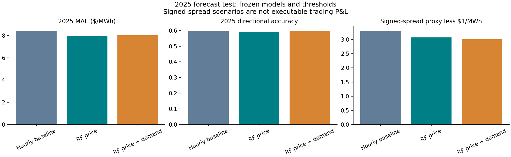

# CAISO Power Spreads: Forecasts, Risk and Decision Discipline

**One detailed power-market research project.** Analyse price components, compare forecasting methods, and decide whether a signal survives realistic questions about information timing and risk.

## Start here: two transparent evaluations of one research question

The dataset now covers **17,544 hourly CAISO observations across 2024–2025**, with archived day-ahead system and regional demand forecasts.

| Evaluation | Main finding | Read |
|---|---|---|
| Conservative 2024 signal audit | Selected positive spreads averaged $0.682/MWh; an illustrative $1/MWh hurdle removed the average advantage. | [Audit and risk framework](reports/validation_audit.md) |
| Frozen 2024 models, full 2025 test | Price-based RF reduced MAE 5.3% versus an hourly baseline. Added demand forecasts did not improve it further. | [External-year experiment](reports/fundamental_extension.md) |

The 2025 signed-spread selection diagnostic is positive, but **not executable trading P&L**. It references an already-fixed DA price, has no executable quotes, and lacks complete publication vintages. These are different experiments; do not compare their headline hit rates directly.



- [Frozen experiment protocol](docs/fundamental_extension_protocol.md)
- [Interview guide](docs/interview_guide.md)
- [2025 results and manifest](reports/tables/fundamental_extension/)
- [Temporal-integrity tests](tests/)

The original exploratory analysis below is preserved for context. Its top-decile ranking uses the full test prediction distribution and is retrospective. Use the reports above for current conclusions.

## Original exploratory study


I built this project to understand how real-time power prices correct day-ahead market expectations.

The focus is the spread:

```text
RT LMP - DA LMP
```

In plain terms:

```text
day-ahead = auction price reflecting bids, constraints and expectations
real-time = later market-clearing price
spread = difference between those price outcomes
```

The project uses public CAISO OASIS data for `TH_NP15_GEN-APND` in 2024. I chose this source because it provides matched day-ahead and real-time LMPs and includes the price components needed to explain large moves: energy, congestion, and losses.

## Research Question

Can simple market features help identify hours where real-time prices are more likely to settle materially above day-ahead prices?

The project studies this in three steps:

1. Measure the DA/RT spread.
2. Decompose large moves into energy, congestion, and loss components.
3. Test whether simple time-series and market-state features improve spread ranking versus an hourly baseline.

## Data

Default dataset:

```text
Market: CAISO
Node: TH_NP15_GEN-APND
Period: 2024-01-01 to 2025-01-01
Rows: 8,784 hourly observations
```

Fetched reports:

```text
PRC_LMP        Day-ahead market
PRC_INTVL_LMP  Real-time market
```

Real-time interval prices are averaged to hourly timestamps before joining to day-ahead prices.

## Method

The core spread is:

```text
Spread_t = RT_LMP_t - DA_LMP_t
```

The component decomposition is:

```text
RT_LMP - DA_LMP
= (RT_Energy - DA_Energy)
+ (RT_Congestion - DA_Congestion)
+ (RT_Loss - DA_Loss)
```

Features used:

- delivery hour,
- weekday and month,
- day-ahead price level,
- lagged DA/RT spread,
- rolling spread mean,
- rolling spread volatility,
- rolling day-ahead price volatility.

Models:

- hourly baseline,
- Ridge regression,
- Random Forest.

Validation:

- 180-day initial training window,
- 30-day walk-forward test windows.

## Results

Average out-of-sample metrics:

| Model | MAE | RMSE | Directional Accuracy |
|---|---:|---:|---:|
| Hourly baseline | 9.23 | 23.01 | 60.14% |
| Ridge | 8.55 | 20.55 | 65.23% |
| Random Forest | 8.52 | 20.21 | 66.62% |

Top-decile Random Forest signal:

```text
Signal hours: 432
Signal share: 10.0%
Positive-spread hit rate in signal hours: 67.36%
Positive-spread hit rate across all hours: 39.88%
Share of total positive spread captured: 41.19%
```

The model is best interpreted as a ranking tool. It does not forecast every price spike, but it does identify a subset of hours where positive real-time corrections are more concentrated.

## Key Files

- [`notebooks/power_spread_event_decision_framework.ipynb`](notebooks/power_spread_event_decision_framework.ipynb)
- [`reports/research_brief.md`](reports/research_brief.md)
- [`docs/data_selection.md`](docs/data_selection.md)
- [`docs/market_math.md`](docs/market_math.md)
- [`docs/decision_framework.md`](docs/decision_framework.md)

## Run

```bash
pip install -r requirements.txt
PYTHONPATH=src python scripts/run_analysis.py
```

The script fetches CAISO data if the raw CSV is not already present.

