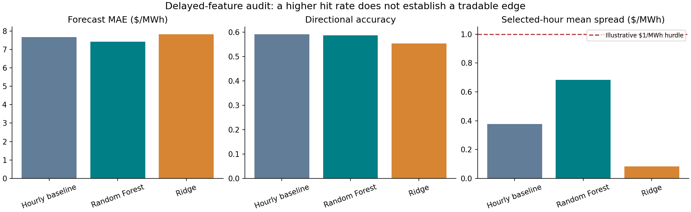
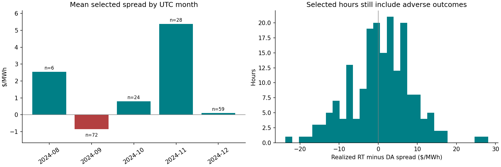
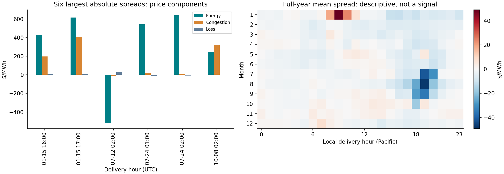

# From a power-price signal to a defensible decision

## Decision first

**Do not treat this price-only signal as an executable trading strategy.** The delayed-feature Random Forest selects 189 of 3,433 evaluation hours. The average realized RT-minus-DA spread is $0.682/MWh, with a 55.0% positive-spread rate. A hypothetical $1/MWh hurdle takes the average to -$0.318/MWh. The approximate daily-block bootstrap interval for the gross selected mean is **[-$1.58, $2.98]/MWh**. The data do not establish a reliable positive edge.

This is a completed research evaluation with a negative deployment decision. It is useful for studying selection discipline, prediction timing, tail risk and the distinction between market understanding and trade execution.

## What was measured

CAISO OASIS prices for `TH_NP15_GEN-APND`, 8,784 hourly observations covering the 2024 Pacific delivery year. Real-time interval LMPs were averaged to hourly observations. `spread = hourly RT LMP - DA LMP`, in USD/MWh.

These are retrospective price observations. The hourly real-time average is not asserted to reproduce the settlement rules of a specific instrument. There are no executable bid/ask quotes, fills, available depth, weather forecast vintages, position records or participant fees in this dataset. A price spread is not an achieved return.

## Why re-evaluate the original result?

The original notebook uses current delivery-day DA prices, rolling spread inputs delayed one hour, and a signal threshold calculated from the entire out-of-sample prediction distribution. Its top-decile statistics are a **retrospective ranking**. They do not describe a threshold fixed before trading. The original 66.62% directional accuracy is an average over its original test folds, not the accuracy of this audit.

The new audit changes several things together: feature timing, threshold calibration, training splits and evaluation dates. Differences between the two analyses cannot be attributed solely to look-ahead bias, nor are their metrics directly comparable.

## Chronology and rules

1. Check unique, continuous hourly UTC timestamps before making row-based lags. Derive Pacific calendar features from timezone-aware UTC; this handles daylight-saving transitions.
2. Use calendar features plus spread and DA-price history delayed at least 48 hours. No current-delivery DA price or realized RT input enters the forecast.
3. Start with 4,320 usable training observations. Leave 48 hours before a separate 720-hour calibration window, then a further 48 hours before testing.
4. Fit the hourly baseline, Ridge and Random Forest only on training labels. Scaling is fitted inside Ridge's training pipeline.
5. Set each model's selection threshold to the larger of zero and its 90th percentile calibration prediction. Select a test hour only if its prediction is positive and at least that threshold.
6. Freeze models and thresholds for a 720-hour test window; refresh lagged inputs hourly. Expand history at the next fold. Retain the final partial window.
7. Evaluate all three models on the same 3,433 hours, from 11 August 2024 07:00 UTC to 1 January 2025 07:00 UTC, across five folds.

The 48-hour delay is a conservative research assumption, **not proof of publication availability**. An actual strategy requires a forecast timestamp for each order and archived values available at that time. A prior-day auction decision would require every delivery-hour prediction to be frozen before the applicable auction gate. This hourly-updating evaluation does not implement that schedule.

## Results on a common sample

| Model | MAE ($/MWh) | RMSE ($/MWh) | Direction accuracy | Selected hours | Selected positive rate | Mean selected spread ($/MWh) |
|---|---:|---:|---:|---:|---:|---:|
| Hourly baseline | 7.670 | 18.522 | 59.13% | 429 | 46.85% | 0.377 |
| Ridge | 7.833 | 18.711 | 55.35% | 250 | 44.40% | 0.082 |
| Random Forest | 7.432 | 18.582 | 58.58% | 189 | 55.03% | 0.682 |

Random Forest modestly improves MAE, but does not beat the hourly baseline on directional accuracy or RMSE. A calibration top-decile rule selects only 5.5% of test hours: the prediction distribution changes, so a fixed prior threshold does not guarantee a 10% future selection rate. Positive spreads occur in 40.64% of the common evaluation sample.



## Risk and stability matter more than the headline hit rate

- The worst selected Random Forest spread is **-$23.75/MWh**.
- Removing the five best selected hours lowers the mean from **$0.682 to $0.153/MWh**. This is a concentration diagnostic, not an alternative strategy.
- September: 72 selected hours, mean **-$0.86/MWh**. November: 28 hours, mean **+$5.38/MWh**. December: 59 hours, mean **+$0.10/MWh**. August has only six selections, so its higher hit rate is weak evidence.
- Illustrative $1, $5 and $10/MWh hurdles imply selected means of -$0.318, -$4.318 and -$9.318/MWh. These hurdles are scenarios, not measured transaction costs; no dollar P&L or return on capital is claimed.
- The 95% bootstrap interval resamples entire UTC delivery days, keeping within-day selection dependence. It conditions on fixed models and selections, assumes independent days, and does not capture longer serial dependence or research-selection uncertainty.



## What the market data teach us

The price components reconcile within $0.000035/MWh, consistent with rounding of published components. Large moves can involve energy and congestion simultaneously; a positive energy contribution can be offset by congestion. This is accounting attribution, not causal identification.

The full-year heatmap shows negative average RT-minus-DA spreads around the Pacific evening hours in several summer months. This does **not** mean electricity was cheap or demand low. A high real-time price can still be lower than an even higher day-ahead price. The research question is what changed relative to expectations, not simply whether demand or price is high.

The largest event bars and calendar heatmap use the full year and are explicitly exploratory. January's large events are not in the audit's later evaluation period. These charts do not establish a trading rule.



## A decision framework to take further

| Stage | Question | Action supported now |
|---|---|---|
| Data check | Are inputs complete and actually available before the decision? | Reject missing/duplicate hourly inputs; require publication vintages before live use. |
| Directional view | Is RT expected above DA? | A positive high-ranked forecast is a research candidate, not an order. Negative predictions have not been tested as a short strategy here. |
| Fundamental explanation | Did expected demand, renewables, outages or transmission availability change? | Investigate timestamped forecast revisions; these variables are absent from this model. |
| Price comparison | Is the expected outcome better than a currently executable price after fees and spread? | Cannot answer from settlement-price data. No live-entry recommendation. |
| Risk budget | What is the adverse case, position size, liquidity and exposure overlap? | Use observed tails as a warning; define limits with instrument-specific data before paper trading. |
| Deployment | Does the rule survive a genuinely untouched period and costs? | Current decision: no deployment; retain as a monitoring/research prototype. |

Conceptually, a long RT-minus-DA exposure benefits when RT exceeds DA, and a short exposure benefits in the opposite case. This payoff algebra alone does not identify an accessible instrument or provide a trading instruction. For European continuous intraday markets, the relevant comparison is a delivery contract's current executable price versus a forecast exit or settlement value, with contract, timing and settlement conventions explicitly defined. A historical DA price cannot be assumed available as an entry price later in the day.

## Weather and fundamentals: hypotheses, not fitted results

A useful next feature is **net-load forecast revision**, approximately demand revision minus wind and solar revisions. An upward revision could tighten the expected balance; the effect depends on flexible generation, imports, storage and grid constraints. A weather forecast change is informative only through its effect on demand or available generation, its surprise relative to prior expectations, and what prices already reflect.

| Hypothesis | Candidate input | Test needed |
|---|---|---|
| A temperature forecast revision changes cooling/heating demand | Timestamped regional temperature forecasts and load forecasts | Does the load revision improve out-of-sample errors beyond calendar and price lags? |
| Cloud forecast uncertainty changes solar expectations | Forecast solar output by issue time and delivery time | Compare solar forecast revisions, not realized sunshine substituted into historical decisions. |
| Wind forecast revisions change the expected supply balance | Timestamped wind-generation forecasts | Check nonlinear effects and location; a national forecast need not explain a nodal constraint. |
| Evening renewable ramps meet limited flexibility | Forecast net-load ramp, outages, import capability | Separate expected ramps already priced in DA from unexpected revisions. |

**Sources and reading:** [CAISO Today's Outlook](https://www.caiso.com/todays-outlook) defines net demand as system demand minus wind and solar and distinguishes forecast and actual observations. [Modo Energy's intraday methodology](https://docs.modoenergy.com/pages/jan-2026/uk-europe/fundamentals-model/day-ahead-vs-intraday/) explains how updated demand, renewable and availability forecasts relate to intraday repricing. These inform the hypothesis design; this project does not use Modo data or claim to reproduce its model. [Simulation-based forecasting research](https://arxiv.org/abs/2211.13002) studies forecast updates, outages and auction-curve information in European intraday markets.

## What transfers to Northpool, and what does not

Transferable: reasoning about surprise versus expectation, delivery-period specificity, risk versus reward, time-ordered validation, adverse outcomes and disciplined decisions not to trade.

Not established: European 15-minute product expertise, continuous-market execution, cross-border capacity analysis, order-book depth, shift trading or live P&L. The Northpool vacancy is European intraday; CAISO is a distinct US market design. The project is an analytical foundation for learning that market, not evidence of already trading it.

## Reproduce and inspect

From the project directory, install `requirements-audit.txt`, then run:

```bash
PYTHONPATH=src python -m unittest discover -s tests -v
PYTHONPATH=src python scripts/run_validation_audit.py
PYTHONPATH=src python scripts/build_audit_report.py
```

If the cached raw CSV is missing, `PYTHONPATH=src python scripts/run_analysis.py` uses the original OASIS downloader. Fresh downloads may reflect data revisions; compare the SHA-256 in [manifest.json](tables/validation_audit/manifest.json). Raw market data is excluded from Git. The saved predictions, split dates, thresholds, fold metrics, monthly diagnostics and source-data hash support review without rerunning the download. Numerical results can differ across library versions; the manifest records the evaluated environment.

The earlier analysis remains available for comparison. This audit is the main reference for CV discussion and research conclusions.
