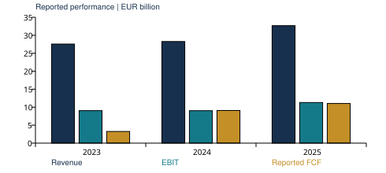

# ASML: financial analysis and valuation

Independent project by Shubham Vijay Nanewar. Information cutoff and market reference: 4 November 2026. Prepared 5 November 2026. All ASML financial amounts are EUR million unless specified.

## Research question

What operating performance and cash conversion would support ASML's observed share price, and how much of a valuation depends on long-term assumptions?

This project combines reported financial analysis, a five-year operating forecast, a discounted cash flow model and a historical peer-multiple comparison. It is an independent learning exercise. It is not transaction experience, an investment recommendation, or a fully integrated three-statement model.

## Business and commercial context

ASML supplies lithography systems and related software, inspection and services used by semiconductor manufacturers. EUV supports advanced patterning, while DUV serves a broader set of manufacturing steps. Customer support and upgrades provide a second revenue source linked to the installed equipment base. The important economic questions concern customer capital expenditure, lithography intensity, equipment delivery and acceptance, capacity constraints and service demand.

Revenue recognition does not occur simply because an order is announced. Backlog, bookings and recognised revenue describe different stages of the commercial process. Customer advances help fund production but also create delivery obligations. They should not be treated as recurring profit or as unrestricted surplus capital.

ASML's 2024 Investor Day described potential 2030 revenue of EUR44-60 billion and gross margins of 56-60%. The October 2026 release subsequently guided 2026 revenue to EUR44-45 billion and discussed stronger customer demand. These are dated company statements, not guarantees. The base scenario reaches approximately EUR58.9 billion revenue in 2030. The upside scenario exceeds the older range and explicitly assumes a stronger demand and execution outcome.

## Reported financial performance

FY2025 revenue was 32.67 billion, EBIT was 11.30 billion and reported free cash flow was 11.03 billion. Revenue increased 15.6% from 2024. EBIT margin was 34.6%; gross margin was 52.8%. The analysis uses US GAAP consistently. IFRS capitalisation of development costs would change the profit comparison and is not mixed into the model.

Reported free cash flow is operating cash flow less cash purchases of property, plant and equipment and intangibles. It is not the same quantity as DCF unlevered free cash flow. The 2025 figure also reflects working-capital timing and customer funding. The simplified core working-capital measure, including current and noncurrent customer advances, was -8.00 billion. It excludes other operating assets and liabilities and is not a complete operating working-capital balance.

## Forecast design

The forecast starts from the EUR44.5 billion midpoint of the October 2026 revenue guidance. Forecast years are 2027-2031. Revenue growth, gross margin, R&D, SG&A, operating tax, depreciation, cash capex and normalised working capital are explicit inputs. Assumptions are editable in Excel; one case selector drives the same forecast and valuation.

Base revenue growth is 8%, 8%, 7%, 6% and 5%. Gross margin rises from 56% to 58%; R&D remains 10.5% of revenue and SG&A 3.2%. The combination implies operating leverage and an EBIT margin of 44.3% by 2031. This is a substantial improvement from FY2025 and deserves scrutiny. The downside holds gross margin at 53-54% with slower growth and higher expense ratios. The upside assumes stronger growth, 57.5-62% gross margin and greater operating leverage.

Normalised working capital is 10% of revenue, with a 2026 estimated starting balance of EUR4.45 billion. This is an analyst convention that deliberately does not extrapolate the reported negative balance funded by customer advances. It is not a forecast roll-forward of actual receivables, inventory and customer deposits. A model of each of those balances would be needed to judge how sustainable prepayment funding is.

## DCF method and results

Unlevered free cash flow equals EBIT after operating tax, plus depreciation, less cash capex and increases in normalised working capital. R&D remains expensed. Share-based compensation is not added back. Annual cash flows use year-end discounting. The remaining 2026 stub uses an explicit Q4 forecast, prorated for 57 remaining days out of a 95-day quarter. This assumes even cash generation within the quarter and is not a substitute for October actuals.

The discount rate is an illustrative 9.5%, not an empirically estimated WACC. Terminal growth is 3%. The terminal cash flow is rebuilt using the operating assumptions and the reinvestment required by terminal growth; it is not simply the last forecast cash flow multiplied by 1.03. The sensitivity table varies WACC from 7.5% to 11.5% and terminal growth from 2% to 4%.

| Scenario | 2031 revenue, EUR bn | DCF EUR/share | Terminal share of EV |
|---|---:|---:|---:|
| Base | 61.8 | 764.92 | 74.7% |
| Downside | 51.1 | 558.27 | 72.9% |
| Upside | 70.3 | 942.86 | 76.0% |

The observed 4 November close is EUR1337.60. The base model gives EUR764.92, approximately -42.8% relative to that price. The gap does not establish mispricing. It shows that the market price requires more favourable operating assumptions, a lower discount rate, stronger long-term cash generation, or some combination. Terminal value represents 74.7% of base enterprise value, so a precise-looking per-share result should not be mistaken for precise knowledge.

## Enterprise-to-equity adjustments

The bridge adds Q3 cash and short-term investments, deducts a EUR2 billion assumed operating-cash reserve and deducts estimated debt. Debt is approximated from December 2025 borrowings less nine-month debt and finance-lease repayments; it is not an exact Q3 balance and mixes debt and lease cash movements. The bridge adds Q3 equity investments, equity-method investments and loans at book value because their returns are not included in forecast EBIT. Their fair values, restrictions and strategic importance are not appraised separately. The denominator is Q3 basic weighted-average shares, 383.1 million, used as a proxy for ending shares. These adjustments are visible rather than described as exact market-value inputs.

## Peer comparison

Applied Materials, Lam Research and KLA provide equipment-industry context. They are not identical businesses: ASML focuses on lithography, Applied Materials has broader equipment exposure, Lam focuses on deposition and etch, and KLA focuses on process control. Differences in growth, margins, service mix and technology position can justify different multiples.

The peer table combines 4 November 2026 prices with FY2025 net income, revenue, cash, debt and shares. Later split-adjusted share counts are used where restated in SEC data, but subsequent buybacks are not reconstructed. These are explicitly historical-denominator diagnostics, not current TTM or consensus forward trading comparables. No multiple-derived target price is presented. Ratios are calculated in each company's reporting currency, so no FX conversion is required. Absolute EUR and USD figures should not be added or compared without conversion. Some peer cash inputs exclude short-term investments, making EV/sales approximate.

## Risks and questions for a client discussion

The key operating risks are customer capital-expenditure delays, export restrictions, supplier and production constraints, equipment acceptance timing, new-product adoption and service demand. The model translates these into growth, margin and reinvestment assumptions; it does not attempt to forecast geopolitical events.

For a financing or strategic discussion, I would first ask whether the issue is valuation, funding capacity, investment timing or shareholder returns. The model can support those questions, but it cannot determine debt capacity, recommend an acquisition or establish a hedge without additional work on contractual cash flows, financing terms and client objectives.

## What I would improve next

Replace the stub cash-flow approximation with actual intra-quarter cash information, use an exact debt and diluted-share bridge, forecast customer advances and inventory separately, estimate a market-supported discount rate, and rebuild peer metrics on matched TTM periods and dated share counts. These improvements could materially change the valuation.

## Reproduction and checks

`src/analyse.py` parses consolidated XBRL facts, excludes dimensional disclosures, chooses the most precise repeated facts and performs a separate Python valuation. Six tests cover reported statement identities, source controls, cash-flow bridges, scenario ordering and sensitivity direction. `src/build_workbook.mjs` checks all three Excel cases and all 25 native sensitivity-table values against Python, changes a late-year growth input to confirm recalculation, restores the base case and scans for formula errors. Excel desktop interaction has not been tested.

## Sources

- [ASML 2025 Form 20-F, US GAAP](https://www.sec.gov/Archives/edgar/data/937966/000162828026011378/asml-20251231.htm)
- [ASML 2024 Form 20-F, US GAAP](https://www.sec.gov/Archives/edgar/data/937966/000093796625000009/asml-20241231.htm)
- [ASML Q3 2026 statements](https://www.sec.gov/Archives/edgar/data/937966/000162828026065813/financial_statementsxusx.htm)
- [ASML October 2026 outlook](https://www.investor.asml.com/news-releases/news-release-details/asml-reports-eu11.7-billion-total-net-sales-and-eu5.0-billion-net-income-q3-2026)
- [ASML 2024 Investor Day](https://investor.asml.com/news-releases/news-release-details/asml-provides-updated-view-market-opportunities-2024-investor-day-meeting)
- [ASML products](https://www.asml.com/en/products)
- [Peer financials](https://data.sec.gov/api/xbrl/companyfacts/CIK0000006951.json)
- [Dated market prices](https://query1.finance.yahoo.com/v8/finance/chart/ASML.AS?period1=1793664000&period2=1793836800&interval=1d)
- Peer SEC company facts: Lam CIK0000707549 and KLA CIK0000319201. Exact filing accession numbers are in the peer CSV and workbook.
