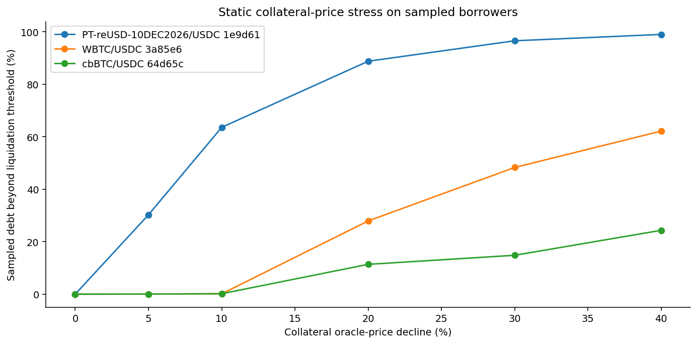

# Crypto Venue Data and Morpho Lending Risk

A Python research project connecting public exchange data with on-chain lending risk. It asks two practical questions: does a visible price gap survive trade size and costs, and what can public lending data tell a desk about collateral and exit liquidity?

**[Read the research report](REPORT.md)** | [Download the self-contained HTML report](REPORT.html) | [Methods](docs/METHODOLOGY.md) | [Data dictionary](docs/DATA_DICTIONARY.md)

## Published sample

Collected on **31 October 2026**, using Coinbase Exchange, Kraken and Morpho's public APIs:

- 24 paired ETH/USD book observations, with retrieval timing and source checks.
- 349 completed Coinbase hourly candles and 720 completed Kraken candles.
- 30 large listed Ethereum lending markets and 1,346 borrowers across three USDC markets.
- Five USDC V1 vaults, including allocation, concentration and withdrawal-capacity diagnostics.
- Two oracle observations for each market, with feed and conversion-vault dependencies.
- 75 archived responses with checksums, 11 analysis tables and six figures.
- 24 passing unit and archived-data tests in the reference environment.

The largest gross cross-venue difference in this short sample was **1.29 bps**. At an assumed fee of 10 bps per leg, the best net difference was **-18.69 bps**. This is a useful negative finding, not a profitable strategy claim.

The borrower stress test shows a different risk question. At a 10% collateral-price decline, the debt beyond the liquidation threshold differs substantially between the three markets. This is conditional threshold exposure, not expected loss. Details and caveats are in the report.



## What is implemented

1. **Public venue adapters.** Product metadata, order-book snapshots, candle history, request timing, bounded retries and error handling.
2. **Opportunity screening.** Same-quantity paired fills, depth-aware VWAP, four sizes, six fee scenarios and preliminary timing checks.
3. **Lending risk.** Utilisation reconciliation, borrow-share conversion, exact integer health checks and collateral-price stress.
4. **Vault diagnostics.** Collateral concentration, queue-aware withdrawal estimates, timelocks and provider warnings.
5. **Oracle review.** Dependency inventory and two-observation changes, with underlying feed freshness explicitly unknown.
6. **Desk handoff.** Research alerts, a go/no-go assessment, contract-reading notes and a prioritised technical backlog.

The project uses public read-only endpoints. It does not trade, sign transactions, hold keys or manage a live vault. Its contract reading is not a security audit. It is an independent project and is not affiliated with Flowdesk, Morpho or either exchange.

## Reproduce the archived analysis

Python 3.11 is recommended. The reference run used Python 3.9 with the versions in `requirements-reference.txt`.

```bash
cd digital-assets/venue-and-lending-risk
python -m venv .venv
source .venv/bin/activate
pip install -r requirements.txt
PYTHONPATH=src python -m unittest discover -s tests -v
PYTHONPATH=src python -m desk_risk.analyze
PYTHONPATH=src python -m desk_risk.report
```

Rebuilding requires no API access after installing dependencies. `analyze` verifies every archived response checksum before calculating outputs. The HTML report embeds its figures and can be opened offline. Supporting appendices remain separate Markdown files.

## Collect a new observation window

```bash
PYTHONPATH=src python -m desk_risk.collect --rounds 24 --interval 8
PYTHONPATH=src python -m desk_risk.enrich
PYTHONPATH=src python -m desk_risk.analyze
PYTHONPATH=src python -m desk_risk.report
```

This makes public network requests and creates a new timestamped directory. It does not overwrite the reference responses. Collection is rate-limited by the polling interval and uses two concurrent book requests. No account or API secret is required. The GraphQL schema can change; required response failures stop collection rather than produce invented observations. `enrich` must complete before generating the full report. Reference result descriptions in this README and the desk memo refer to the published sample; a new report is calculated from its own tables.

To rebuild a specific archived collection:

```bash
PYTHONPATH=src python -m desk_risk.analyze --run 20261031T103525Z
```

`report` reads the collection selected in `data/LATEST`; set that file to the intended run before generating a report for another archive. Archived-data tests check coverage against the selected sample and intentionally fail if a future collection is incomplete.

## Repository guide

| Location | Contents |
|---|---|
| `src/desk_risk/collect.py` | HTTP collection and provenance |
| `src/desk_risk/enrich.py` | Second oracle observation and source licence |
| `src/desk_risk/metrics.py` | Book sizing and integer lending calculations |
| `src/desk_risk/analyze.py` | Offline normalisation, analysis and charts |
| `src/desk_risk/report.py` | Markdown and self-contained HTML reporting |
| `queries/` | Exact GraphQL requests |
| `data/raw/` | Original responses, request metadata and checksums |
| `outputs/` | Derived tables and numerical summary |
| `figures/` | Reproducible PNG charts |
| `tests/` | Calculation, failure-path and archive checks |
| `docs/` | Methods, source review, data dictionary and desk assessment |

## Read in this order

1. [Research report](REPORT.md): observations and interpretation.
2. [Methods](docs/METHODOLOGY.md): formulas, units and assumptions.
3. [Data dictionary](docs/DATA_DICTIONARY.md): schemas, provenance and timing.
4. [Contract reading](docs/CONTRACT_REVIEW.md): how Solidity informed the calculations.
5. [Desk decision and backlog](docs/DESK_DECISION.md): what remains before production use.
6. [Learning guide](docs/LEARNING_GUIDE.md): exercises for independently explaining the work.
7. [Sources and reuse](docs/SOURCES.md): official documentation and third-party source licence.

## What remains open

The exchange observation window is about three minutes. REST books are not synchronised, fees are assumptions, and no fills are executed. Morpho positions are indexed at different times rather than pinned to one block. Oracle feed freshness, deployed bytecode equivalence, liquidation execution costs and curator operational controls remain unverified. These are explicit next steps, not hidden assumptions.
