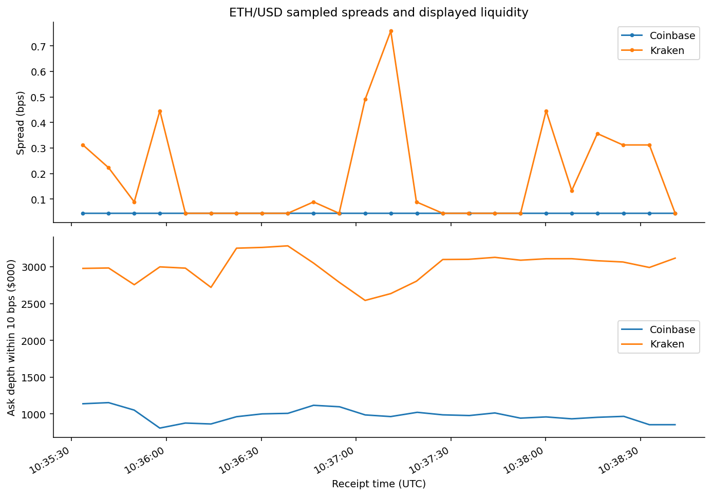
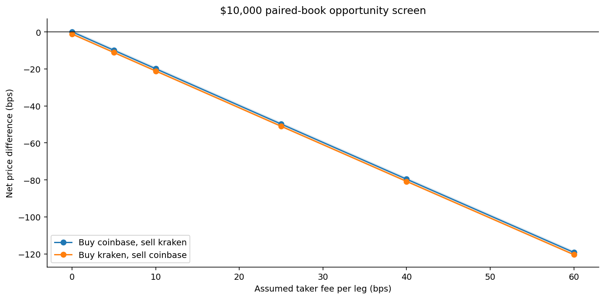
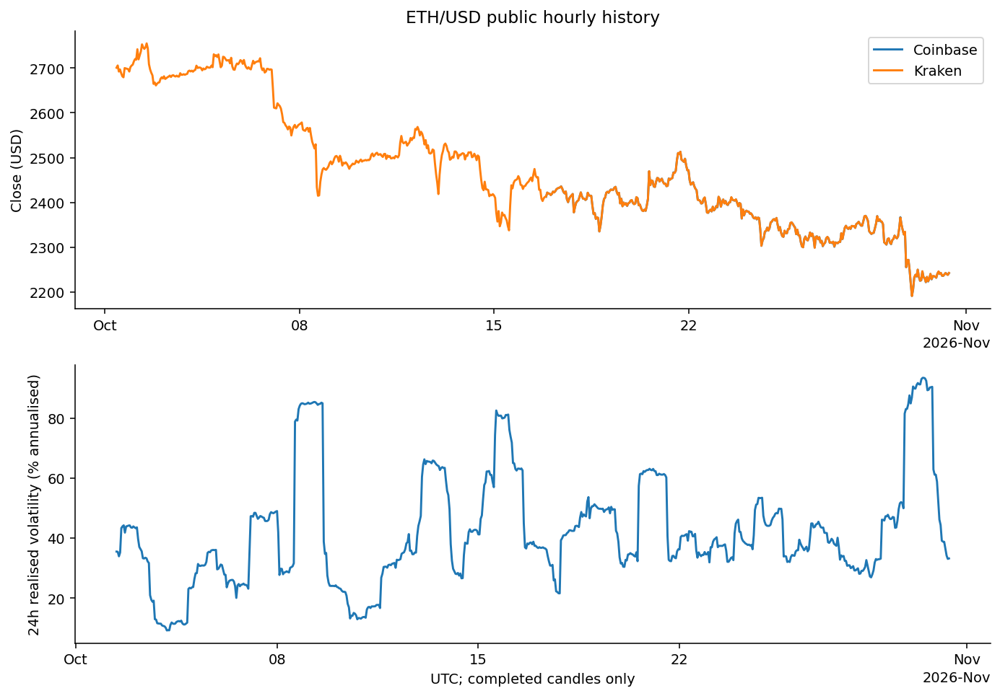
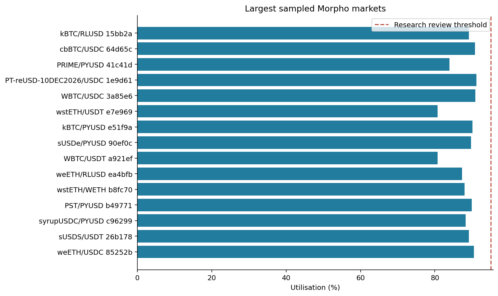
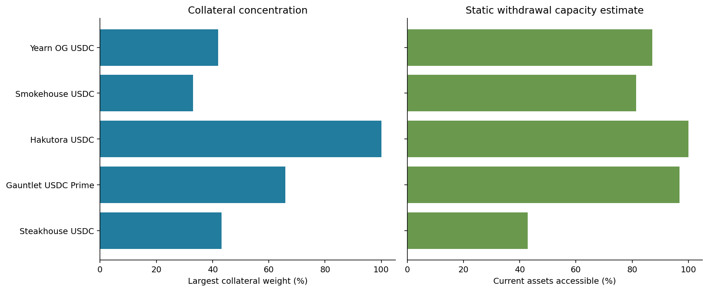

# Crypto Venue Data and Morpho Lending Risk

Research report | 31 October 2026

## Research question

Can public exchange and lending-protocol data support a useful desk screen for liquidity, pricing gaps and collateral risk? This project builds two read-only exchange adapters and a Morpho data integration, then follows the observations through validation, calculations and a desk decision. It uses no private accounts, wallet keys or trading permissions. The purpose is to understand what the data can support and where it stops being sufficient.

## Main findings

The collection contains 48 ETH/USD order books across 187.4 seconds, 30 Ethereum lending markets, 1,346 borrower positions and 5 USDC vaults. The largest gross cross-venue difference was 1.29 basis points. With an assumed fee of 10 basis points per leg, the best net difference was -18.69 basis points. The sampled price differences therefore do not support a trade at that cost assumption. Borrower stress and vault withdrawal capacity vary substantially even where the loan token is the same.

### Collection coverage

| Measure | Value |
| --- | --- |
| Collection ID | 20261031T103525Z |
| Final retrieval time (UTC) | 2026-10-31T10:39:20.421781+00:00 |
| Archived HTTP responses | 75 |
| Paired exchange observations | 24 |
| Coinbase completed hourly bars | 349 |
| Kraken completed hourly bars | 720 |
| Maximum book receipt skew | 0.319 seconds |
| Paired Morpho oracle observations | 30 |

## Data provenance

Coinbase Exchange and Kraken supply public ETH/USD books, product metadata and recent hourly candles. Morpho supplies indexed market, position, vault and oracle configuration data. Each raw response has a request URL, retrieval times and SHA-256 checksum in the manifest. The archive is a reproducibility record, not a guarantee that an external provider is always correct. The appendix links the exact queries, data dictionary, methods, source references and contract review.

## Exchange liquidity

The median displayed spread was 0.045 bps on Coinbase and 0.089 bps on Kraken. 6 paired observations fail the preliminary timing gate because a source quote is too old under the two-second rule. They remain in the descriptive tables and charts, but are flagged against execution use. A narrow best spread is only the first level of the book. The depth calculation measures how much displayed USD value is available within 10 bps of the midpoint. The sizing screen walks the book for the same ETH quantity on each leg. It rejects an incomplete fill rather than assuming the remaining quantity trades at the last observed price.

Observed spreads and ask-side depth. The window is short and descriptive.

## Costs and trade size

Four target notionals, from $1,000 to $100,000, are evaluated in both directions. Six fee assumptions are applied independently to both legs. Fees are not taken from an authenticated account schedule. Inventory is assumed to be pre-funded. Leg risk, borrowing, transfers, custody limits and adverse selection remain outside the calculation. A candidate must survive those checks before it could become an executable proposal.

Median net difference and observed range at a $10,000 target. The zero line separates positive and negative calculations, not verified executable trades.

## Historical context

The available hourly data span 2026-10-01 10:00:00+00:00 to 2026-10-31 09:00:00+00:00. Kraken provides a longer sample than Coinbase in this capture. Incomplete candles are removed; missing hours are not filled. The rolling volatility chart describes recent market conditions. It is not a fitted forecast or evidence of a trading signal.

Hourly prices and a trailing 24-hour realised-volatility estimate.

## Lending markets

Market utilisation is recomputed from the raw supply and borrow balances. The maximum discrepancy against the provider value is 0. 0 of the 30 sampled markets exceed the 95% research review threshold. That does not establish low overall risk. High collateral concentration, liquidation sensitivity, issuer risk and limited vault exits can exist below that threshold. The selection contains large listed markets, which is a deliberate selection bias.

The 15 largest sampled markets by supplied USD. Market ID fragments distinguish similar pairs.

### Borrower coverage

| Market ID prefix | Sampled USDC debt | Positions | Reported USDC debt | Coverage |
| --- | --- | --- | --- | --- |
| 0x1e9d614631 | 123,488,395.36 | 257 | 123,488,395.36 | 100.000000% |
| 0x3a85e61975 | 122,409,935.95 | 645 | 122,409,935.95 | 100.000000% |
| 0x64d65c9a2d | 212,738,678.06 | 444 | 212,738,678.06 | 100.000000% |

## Borrower stress

Debt is derived from borrow shares with the contract's upward rounding convention. Collateral value and supported debt are rounded down. The stress test then reduces the oracle price while holding debt and collateral quantity constant. At a 10% shock, the shares of sampled debt beyond the threshold are PT-reUSD-10DEC2026: 63.60%; WBTC: 0.13%; cbBTC: 0.18%. These are conditional sensitivities, not comparative loss probabilities. A 10% principal-token price decline and a 10% BTC decline have different economic meanings. No liquidation process, collateral sale or recovery is simulated.

### Static shock results

| Collateral | Price decline | USDC debt beyond threshold | Share of sampled debt |
| --- | --- | --- | --- |
| PT-reUSD-10DEC2026 | 10% | 78,542,547 | 63.60% |
| PT-reUSD-10DEC2026 | 20% | 109,666,618 | 88.81% |
| PT-reUSD-10DEC2026 | 30% | 119,295,681 | 96.60% |
| WBTC | 10% | 155,889 | 0.13% |
| WBTC | 20% | 34,179,236 | 27.92% |
| WBTC | 30% | 59,128,480 | 48.30% |
| cbBTC | 10% | 376,520 | 0.18% |
| cbBTC | 20% | 24,191,010 | 11.37% |
| cbBTC | 30% | 31,531,247 | 14.82% |

Threshold exposure increases as the collateral-price shock increases. Exposure is not expected loss.

## Vault concentration and withdrawals

The five sampled vaults allocate the same loan token across different markets. Steakhouse USDC has the lowest estimated immediate withdrawal capacity at 42.81% of saved assets. The highest estimate is 100.00%. Hakutora USDC has the largest collateral concentration at 100.00%. These figures describe the archived configuration. They are not a judgment of a curator's strategy or a current recommendation. The withdrawal estimate assumes no competing withdrawals and excludes reallocation. Capacity across vaults cannot be added when they share markets.

### Vault observations

| Vault | Active markets | Largest collateral weight | Withdrawal estimate | Timelock hours |
| --- | --- | --- | --- | --- |
| Steakhouse USDC | 10 | 43.24% | 42.81% | 168.0 |
| Gauntlet USDC Prime | 7 | 65.93% | 96.81% | 168.0 |
| Hakutora USDC | 1 | 100.00% | 100.00% | 72.0 |
| Smokehouse USDC | 14 | 33.00% | 81.43% | 72.0 |
| Yearn OG USDC | 6 | 41.97% | 87.20% | 72.0 |

Concentration and static withdrawal capacity answer different risk questions.

## Oracle observations

All 30 markets were matched across the two observations. 13 indexed state timestamps advanced. The largest absolute oracle-price change was 0.0257 bps. Feed and conversion-vault dependencies are recorded separately. A small price change or an unchanged timestamp does not establish feed freshness. The API response does not supply the underlying feed round timestamps needed for that conclusion. Several prices include conversion-vault dependencies, which need additional review beyond a single market-price comparison.

## Data limitations that affect interpretation

Borrower and market-state timestamps differ by 136 to 151 seconds in the saved sample. Pagination is not block-pinned. Debt coverage is close to 100%, but that alone cannot prove an atomic snapshot. Health factors for dust debts can differ materially because a tiny integer debt change has a large ratio effect. The exchange window covers only about three minutes, the candle history is short, and there is no live execution validation. The top-market and top-vault selection omits smaller venues and protocols. All of these constraints remain visible in the project rather than being absorbed into a performance claim.

### Research alerts

| Rule | Count |
| --- | --- |
| collateral_concentration | 2 |
| low_health_factor | 55 |
| snapshot_timing | 6 |

## Desk decision

Proceed with read-only research and further observation. Do not approve live execution or an allocation from this evidence. The sampled exchange gap does not survive the stated fee scenario. The lending risk screen is useful, but feed freshness, same-block reconciliation, deployed contract verification and collateral-specific liquidation costs remain open. The technical backlog turns each open issue into an owner and an acceptance criterion.

## What this project demonstrates

Public API integration, explicit handling of data types and time, depth-aware pricing calculations, protocol-specific integer arithmetic, borrower stress analysis, vault diagnostics and reproducible reporting. It is a personal research implementation. It does not demonstrate professional production connectivity, a Solidity security audit or a live trading track record.

## Appendices

- [Data dictionary](docs/DATA_DICTIONARY.md)
- [Methods](docs/METHODOLOGY.md)
- [Contract reading](docs/CONTRACT_REVIEW.md)
- [Desk decision and backlog](docs/DESK_DECISION.md)
- [Source references](docs/SOURCES.md)
- [Learning guide](docs/LEARNING_GUIDE.md)
