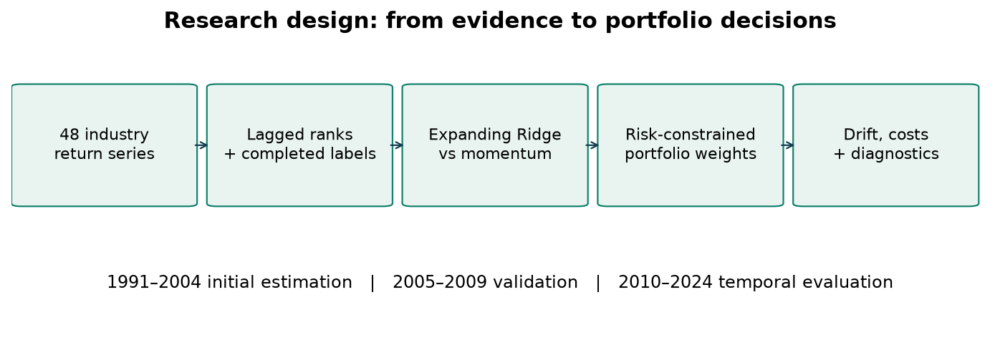
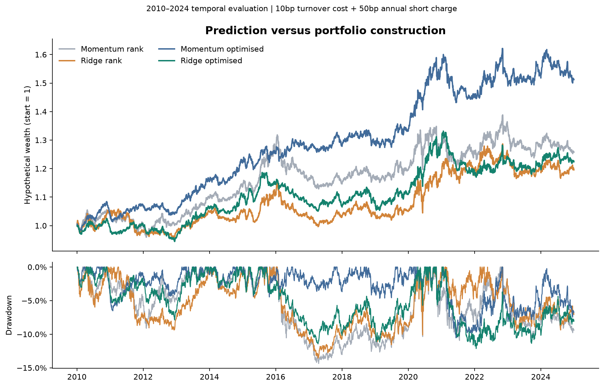

# Cross-Sectional Signals and Portfolio Risk

**Does a statistical return model add value beyond simple momentum once portfolio construction and costs are treated consistently?**

This project studies 48 US industry return portfolios. It connects lagged cross-sectional features, expanding-window Ridge regression, covariance-aware optimisation and a self-financing backtest. It is a **research-proxy study, not a deployable investment strategy**.



## Main finding

The more complex model did not beat the simple benchmark in the 2010–2024 temporal evaluation. Risk-constrained momentum had a **0.60 zero-hurdle Sharpe**, compared with **0.30 for risk-constrained Ridge**, after the same illustrative transaction and short-exposure charges. Momentum also had higher rank IC and lower turnover. These are hypothetical aggregate-portfolio results, not claims of tradable alpha.

| Variant | Net CAGR | Annual volatility | Sharpe (zero hurdle) | Daily max drawdown | Annual turnover |
|---|---:|---:|---:|---:|---:|
| Momentum rank | 1.54% | 5.25% | 0.32 | -14.36% | 4.73 |
| Ridge rank | 1.20% | 4.81% | 0.27 | -13.57% | 6.80 |
| Momentum optimised | 2.79% | 4.78% | 0.60 | -10.54% | 4.99 |
| Ridge optimised | 1.36% | 4.82% | 0.30 | -12.14% | 7.84 |

CAGR and volatility are annualised from monthly returns. Drawdown uses daily net returns. Turnover is total absolute dollars traded per unit NAV, not half-turnover. Base assumptions: 10bp per unit traded; 50bp/year on short exposure; no cash yield or short rebate. Optimisation changes the risk mandate; comparing optimised and rank portfolios is not a controlled test of signal quality alone.



## Read the work

- [Full research report](RESEARCH_REPORT.md): methods, results, diagnostics and limitations.
- [Standalone visual report](RESEARCH_REPORT.html): download and open in a browser; figures are embedded. GitHub displays HTML source rather than hosting the rendered page.
- [Research brief PDF](Research_Brief.pdf): concise shareable report.
- [Interview walkthrough](INTERVIEW_GUIDE.md): explain the study and its difficult questions.
- [Protocol](PROTOCOL.md): fixed design written before the first results.
- [Data provenance](data/README.md): snapshot, block parsing and revision caveats.
- [Results and audit tables](outputs): full monthly/daily results, weights, predictions, coefficients, timing and cost stresses.

## Research design

- **Universe:** 48 industry aggregates; all retained. Daily history 1990–2024; 1990 provides warm-up.
- **Initial estimation:** 1991–2004. **Validation:** 2005–2009. **Temporal evaluation:** 2010–2024 (180 monthly decisions; 8,640 industry forecasts).
- **Features:** 21-day reversal, 63-day momentum, 252-day momentum excluding the latest 21 days, 63-day volatility, 252-day drawdown, and beta to an equal-industry return proxy.
- **Transform:** cross-sectional percentile ranks, centred and scaled; no full-sample normalisation.
- **Target:** next-month industry return less the cross-sectional average. Industry identity is not a feature.
- **Model:** expanding Ridge refit monthly; four normalised penalties (0.1, 1, 10, 100), selected only by validation mean Spearman IC. Selected penalty: 10.
- **Benchmarks/ablations:** momentum/ridge rank portfolios and momentum/ridge optimised portfolios. All four retained, not just the best curve.

### Timing and label availability

For a portfolio held in month m:

1. Use returns through the **penultimate trading day of m-1** for features, beta and covariance.
2. Train only on monthly labels whose last date is strictly earlier than that cutoff. The still-incomplete m-1 label is excluded.
3. Hypothetically execute at the **final close of m-1**. This gives one complete trading session between signal observation and execution.
4. Hold asset quantities throughout m; allow weights to drift. At the next rebalance, charge costs on the difference from drifted weights.

An additional caveat remains: French portfolio aggregates are not available to trade or necessarily published at that time. The timing convention prevents algorithmic look-ahead **conditional on these inputs**; it does not establish real-time data availability. Retrospective data revisions and source-vintage limitations remain.

### Portfolio construction

Let s be cross-sectional ranks of the momentum score or Ridge predictions. Simple weights are s / sum(|s|), with 100% gross and zero net exposure at rebalance.

The constrained portfolio solves:

```text
minimise  (5/2) w' Sigma w - (0.01 s)' w + 0.001 sum(|w - w_previous_drifted|)
subject to sum(w) = 0
           beta' w = 0
           sum(|w|) <= 1
           |w_i| <= 0.05
```

Sigma is Ledoit-Wolf daily covariance from 252 observations, multiplied by 21. Beta is estimated against an equal-industry proxy. Absolute values use auxiliary variables and linear constraints. Solver failure stops the run; it is not silently replaced with a favourable fallback. The `0.01 s` coefficient is a fixed utility scale, not a calibrated expected-return forecast. Beta neutrality and caps hold at rebalancing; subsequent drift can change them. Covariance is used to budget risk, not to predict returns.

### Accounting and uncertainty

The simulator tracks signed dollar holdings and cash, deducts costs at the preceding execution close, charges short exposure daily, and propagates drifted weights. It includes initial entry costs. It marks terminal positions without liquidation. It does **not** compute returns from same-day signal weights or rebalance every day for free.

- Transaction costs: 0, 5, 10, 25, 50bp, with the base short charge held fixed.
- Short charge: 0, 50, 100, 300bp/year, with transaction costs held fixed.
- Separate genuinely frictionless scenario: 0bp transactions and 0bp short charge.
- Paired circular moving-block bootstrap: 12-month blocks, 2,000 repetitions, seed 42. The Ridge-minus-momentum optimised Sharpe difference has a 95% interval of approximately **[-0.62, -0.04]** in this sample.

Intervals are conditional, retrospective diagnostics, not proof of future performance; multiple comparisons, chosen block length and nonstationarity limit interpretation. Stress tests replay fixed targets, so they measure implementation drag rather than reoptimised responses.

## Reproduce

From the repository root:

```bash
cd research-projects/cross-sectional-signals-and-portfolio-risk
python3 -m venv .venv
source .venv/bin/activate
pip install -r requirements-lock.txt
OPENBLAS_NUM_THREADS=1 OMP_NUM_THREADS=1 python src/research.py
python src/present.py
pytest -q
```

Use Python 3.12; the exact environment is pinned in `requirements-lock.txt`. The raw input already lives in this repository's `research-projects/capital-shortfall-under-geopolitical-stress/data` folder. No API key or external download is required to reproduce. The manifest hashes the raw snapshot and protocol. The rendered PDF can be regenerated separately with `python src/pdf_brief.py` after installing ReportLab.

## Limits and research ownership

- Industry aggregates are not directly investable. No constituent-level turnover, actual securities lending, capacity, market-impact or live execution evidence exists here.
- This is cross-sectional equity-industry research, **not multi-asset portfolio research**.
- The inherited CSV has separate return blocks. Its equal-weighted heading is visible, but the initial heading and download metadata are missing. The first-block value-weighted interpretation follows the provider's layout and is not independently revalidated against a fresh download.
- Historical constituent construction avoids selecting today's stocks, but revised data do not provide a point-in-time archive.
- This study is retrospective. The protocol predates this run, not knowledge of the historical period or the broader momentum literature.
- AI-assisted implementation was used. The author should reproduce the study and understand its statistical and accounting choices before presenting it in an interview. It is not professional investment-research experience.

## Sources

- [Kenneth French: 48 industry portfolio construction](https://mba.tuck.dartmouth.edu/pages/faculty/ken.french/Data_Library/det_48_ind_port.html)
- [Kenneth French Data Library: revisions and file-format notes](https://mba.tuck.dartmouth.edu/pages/faculty/ken.french/data_library.html)

No affiliation with, or endorsement by, any investment firm is implied.
