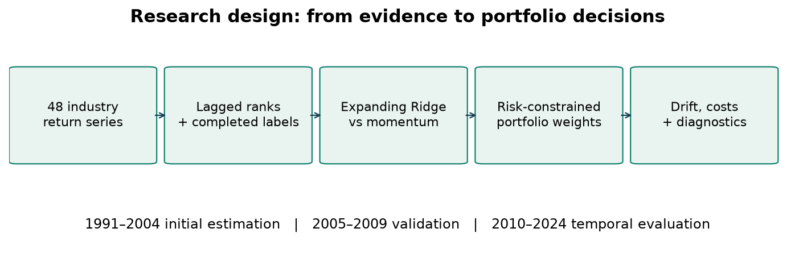
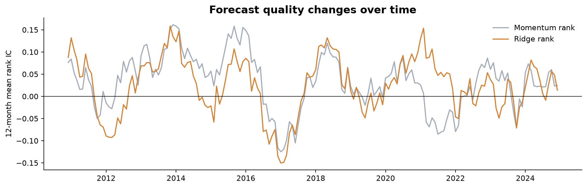
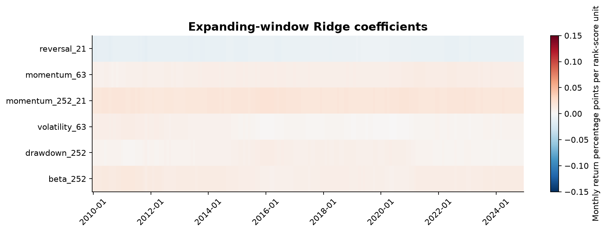
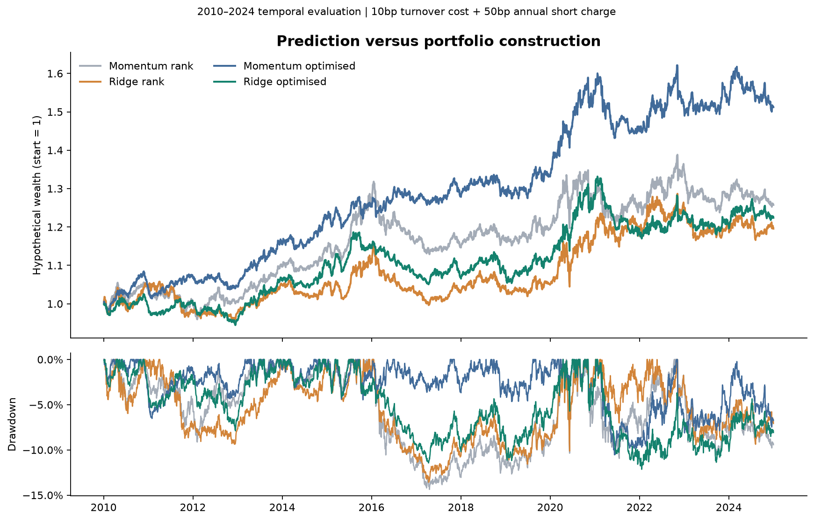
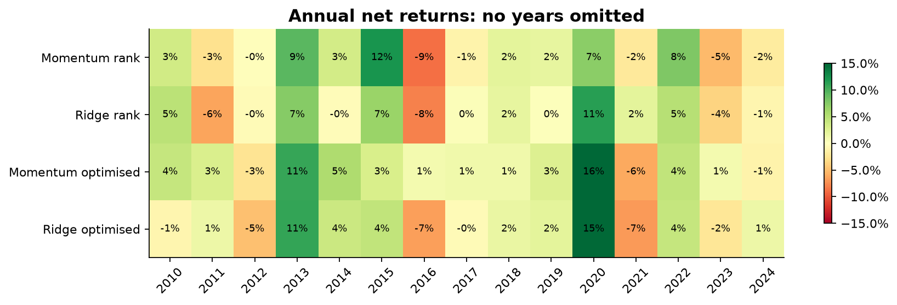
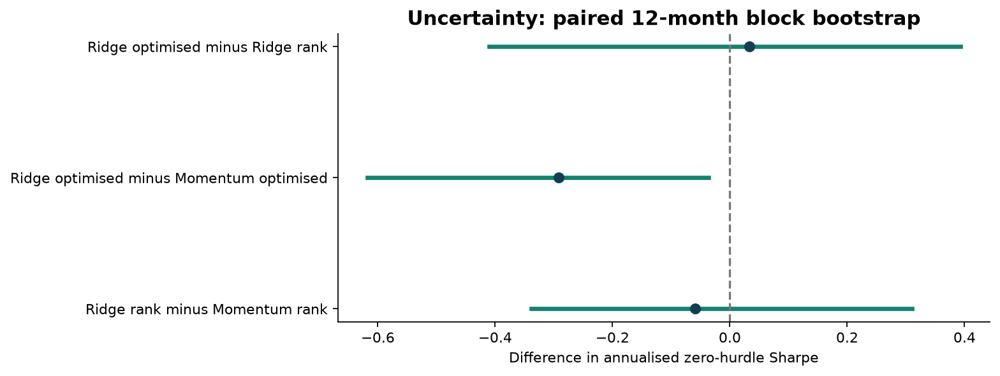
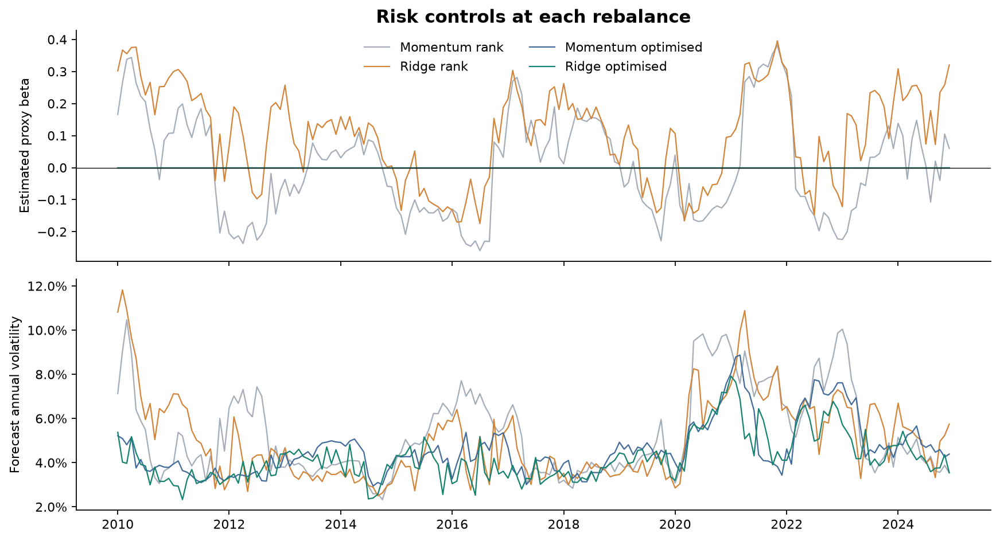
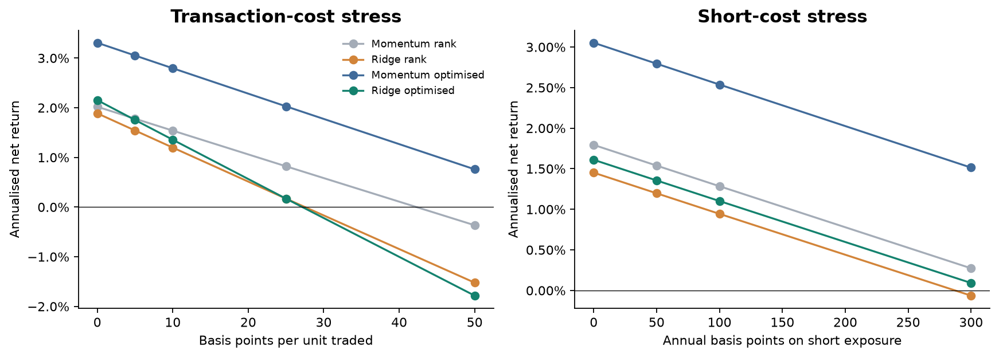

# Cross-sectional signals and portfolio risk

Research study by Shubham Vijay Nanewar.

## Research question

Does combining return-history characteristics improve on a simple industry-momentum signal, and how much of any portfolio difference comes from construction rather than prediction? This study separates these two questions through a four-way comparison.

## Design

Use 48 industry return proxies, with 1990 history for warm-up. Six features: short-term reversal, medium- and long-horizon momentum, volatility, drawdown and proxy beta. Cross-sectional ranks use only information through the penultimate trading day of the previous month. A Ridge model refits monthly on expanding completed labels. Validation selects alpha=10 from four fixed choices. No evaluation-period tuning is performed.

## Result

The Ridge-optimised portfolio returned 1.36% annually with a zero-hurdle Sharpe of 0.30. Under identical portfolio constraints, momentum returned 2.79% with a Sharpe of 0.60. The observed Sharpe difference was -0.30; the bootstrap interval below, rather than that point estimate alone, determines how much confidence to place in it.

Strategy,Net CAGR,Sharpe*,Volatility,Daily drawdown,Annual turnover,Rank IC
Momentum rank,1.54%,0.32,5.25%,-14.36%,4.73,0.035
Ridge rank,1.20%,0.27,4.81%,-13.57%,6.80,0.025
Momentum optimised,2.79%,0.60,4.78%,-10.54%,4.99,0.035
Ridge optimised,1.36%,0.30,4.82%,-12.14%,7.84,0.025

## How to interpret the portfolios

Rank portfolios have 100% gross exposure and zero net exposure at rebalance. The optimiser adds a 5% name cap, a 100% gross cap, estimated beta neutrality to the equal-industry proxy, covariance risk and an explicit turnover penalty. It uses the same score scale for both signals. These are different risk mandates: a higher optimised Sharpe cannot by itself prove a better forecasting model.

## Trading-accounting assumptions

Positions are set at the previous month’s last close using earlier information. Holdings drift between monthly rebalances. Turnover compares target weights with drifted existing weights; costs are deducted before the new month’s returns. Base costs are 10bp per unit traded and 50bp per year on short exposure. Entry costs are included; terminal positions are marked, not liquidated. There is no cash yield, short rebate or positive financing income. Cost stresses hold target weights fixed.

## Limitations that change the conclusion

The data are published research aggregates, not directly tradable securities. Exact constituent trades, borrow availability, spread, liquidity and capacity are absent. Source download metadata and the first-block heading are missing from the inherited CSV; its value-weighted interpretation follows the provider’s layout, not a fresh independent source check. Historical data can be revised; the snapshot is not a point-in-time archive. These results are not an executable strategy or evidence of scalable alpha. The temporal holdout was selected before this run, but is retrospective, not a prospective preregistration.

## What would be needed next

Replicate with licensed point-in-time constituent data or a documented tradable ETF universe; include delistings and historical holdings; estimate instrument-level spreads, borrow and market impact; test against a genuine market factor and broader risk exposures; reserve genuinely unseen future data. Do not select another model on this evaluation period and continue calling it untouched.

## Research integrity

All four variants and negative findings are retained. Ten tests check feature causality, training-label availability, optimiser constraints, holdings drift, entry and borrow charges, and turnover. Automated implementation assistance was used; all claims must be understood and independently reviewed by the author before presenting this as personal research expertise.
