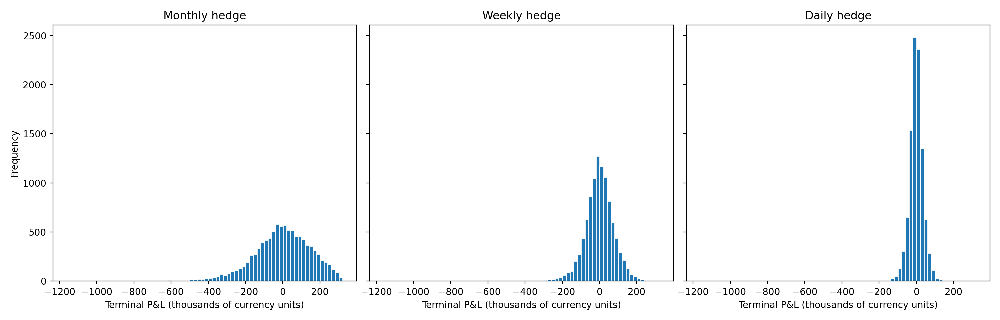

# Numerical validation and research interpretation

## Question

How accurately do numerical methods recover the same European call value, and how does discrete rebalancing change hedge error under the assumed model?

## Corrections and checks

The September 2026 review corrected two implementation issues: the delta hedge is now established at time zero, and cash accrues interest before each later rebalance; the Crank-Nicolson boundary includes both adjacent time levels with the correct time-to-maturity convention. Old figures are superseded by the regenerated outputs.

Three automated tests cover closed-form pricing across moneyness, an exact one-period self-financing accounting identity, and lower hedge-error dispersion with finer rebalancing under the assumed model. The pricing test includes a long-maturity/high-volatility case with an expanded spatial domain. The default three-times-spot boundary is not adequate for every parameter combination; inspect domain and grid sensitivity together.

## Reproducible results

The supplied monthly S&P 500 series runs July 2016 to August 2025. Its original vendor and collection metadata are not recorded in this project, so treat it as a supplied historical input, not a verified current trading dataset. SHA-256: `e39fe92f2275adad63d8fa10ce7d241f27eb129ad92223a1f1a8bd9efc9a38a4`. No data was replaced to improve a result.

Estimated annual historical volatility: 12.7361%; last supplied index level: 6,408.95. The pricing example uses strike 6,500, maturity 0.25 years and a 3% interest rate. These are modelling assumptions, not a claim about current option quotes. Black-Scholes benchmark: 142.9674; 300-step binomial: 142.9070; 400-by-400 Crank-Nicolson: 143.1376. See [pricing table](outputs/pricing_comparison.csv).

Hedging simulations use 10,000 paths, seed 42, 20 contracts with multiplier 100, physical drift 5% and constant model volatility. Each rebalancing grid has its own simulated paths; the same seed does not produce matched paths across frequencies.

| Rebalancing | Terminal P&L standard deviation |
|---|---:|
| Monthly (3 steps) | 153,806.39 |
| Weekly (13 steps) | 77,952.06 |
| Daily (63 steps) | 36,170.86 |

Daily rebalancing reduces standard deviation by 76.48% relative to monthly in this simulation. This is hedge-error reduction, not investment return. Mean P&L is close to zero relative to dispersion, consistent with selling at the model price. [Full hedging table](outputs/hedging_summary.csv).



## What this does and does not establish

More frequent hedging reduces discretization risk under a correctly specified diffusion model. A real trading decision also needs transaction costs, spreads, liquidity, jumps and volatility misspecification. None is included here, so this experiment does not identify an optimal real-world hedge frequency or establish profitable trading.

The Monte Carlo curves vary sample count at a fixed time grid and one seed. They illustrate sampling variability, not a pure time-discretization convergence test. Log-Euler samples GBM exactly at grid times; Euler also has discretization error. Future comparisons should report sampling uncertainty separately.

## Reproduce

```bash
pip install -r requirements.txt
MPLBACKEND=Agg python3 -m unittest discover -s tests -v
MPLBACKEND=Agg python3 src/analysis.py
```

## Interview discussion

Be able to explain risk-neutral versus physical drift; why the initial premium finances stock and cash; both time levels of the PDE boundary; why gamma increases discrete hedge exposure; and why lower simulated dispersion is not proof of live profitability. The 76% result depends on this parameter set and must not be generalised to every market.
